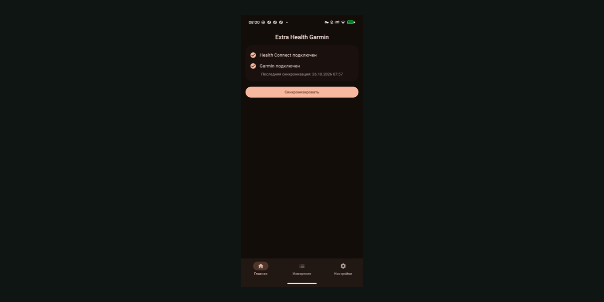
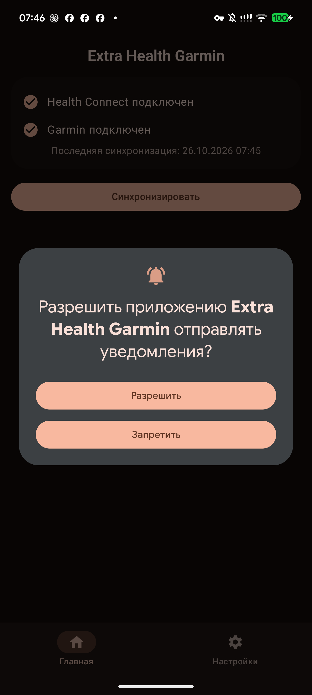
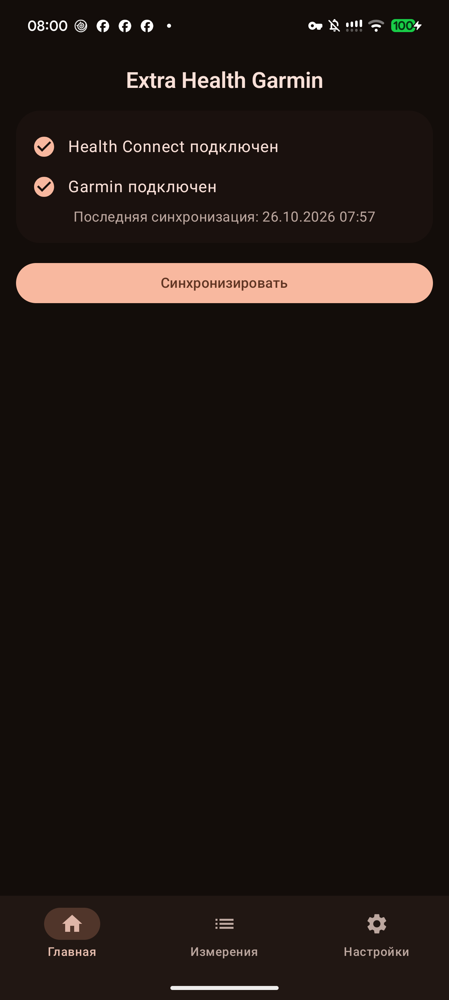
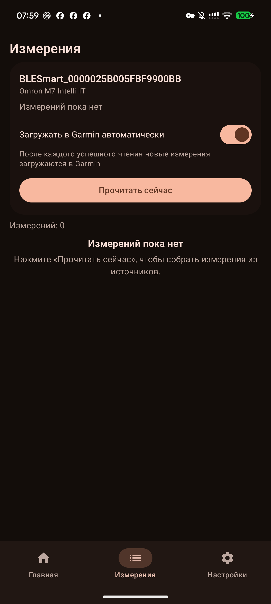
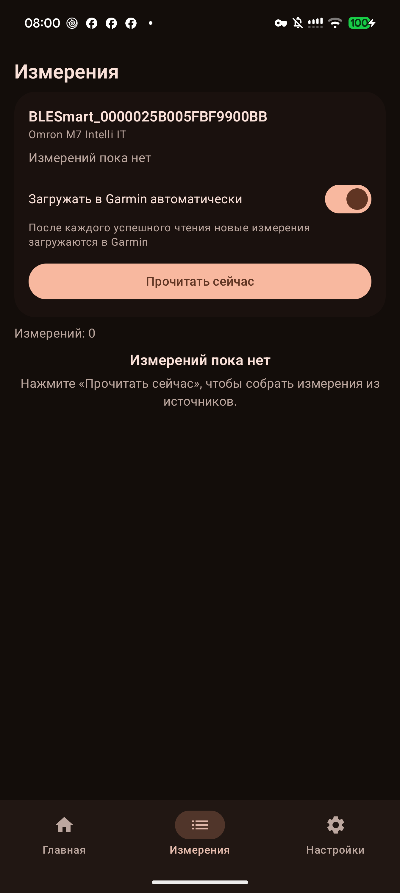
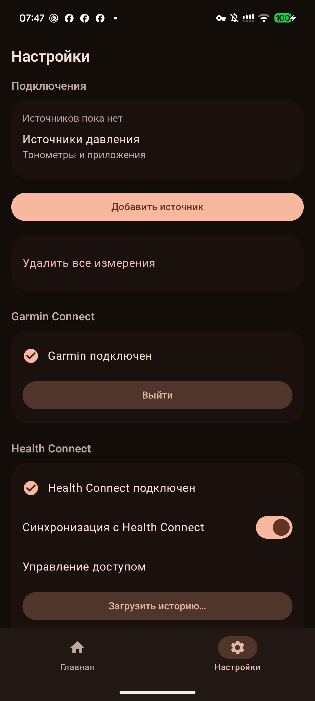
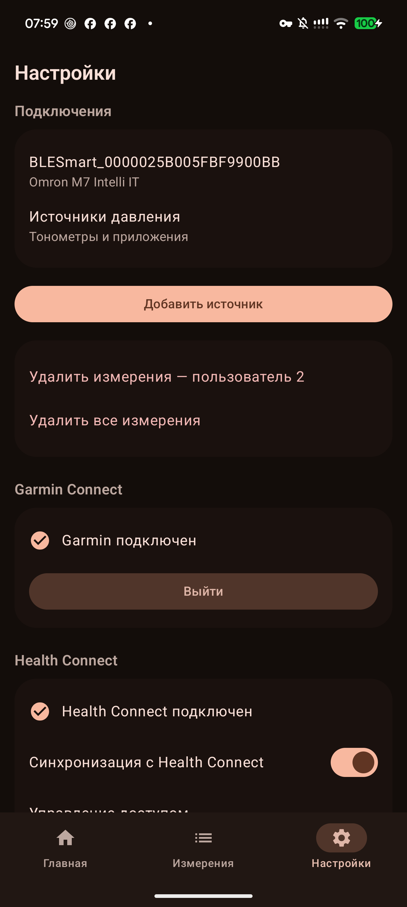
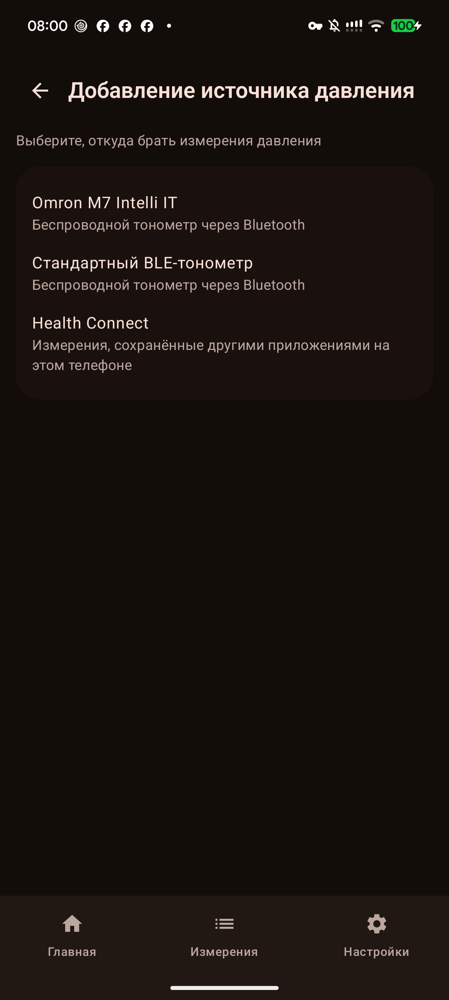
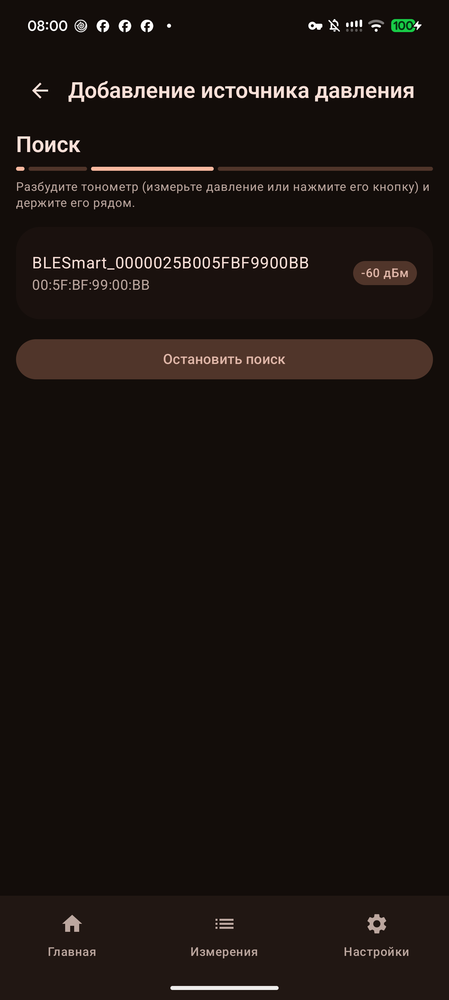

# Extra Health Garmin — Health Connect & blood-pressure monitor to Garmin Connect sync

<p align="center"></p>

[](https://github.com/zamotkin/extrahealthgarmin/releases/latest)
[](https://github.com/zamotkin/extrahealthgarmin/releases)
[](LICENSE)
[](https://developer.android.com)
[](app/build.gradle)
[](https://kotlinlang.org)

**Extra Health Garmin** syncs health data into **Garmin Connect** from the sources you already use. Body-composition weigh-ins come from **Health Connect**. Blood-pressure readings come from pluggable sources you connect in the app: an **Omron M7 Intelli IT** monitor over its own Bluetooth LE protocol, **any standard BLE Blood Pressure Service (0x1810) monitor**, or **Health Connect** itself. Every weigh-in is encoded as a standard FIT weight-scale file and every batch of blood-pressure readings as a FIT blood-pressure file with the official Garmin FIT SDK, and uploaded straight to your Garmin Connect account: no manual CSV export, no middleman server, no analytics, no account data stored beyond encrypted session tokens.

Open source (MIT), no ads, no tracking — just your scale and blood-pressure data where you want it.

## 📱 Features — Health Connect → Garmin body-composition sync

- **🔄 Health Connect source**: reads weight, body fat, bone mass, lean body mass, body water, basal metabolic rate and height measurements from any scale or app that writes into Health Connect
- **🧩 Smart aggregation**: measurements taken at the same time are combined into one weigh-in (weight + fat + BMI, with the height record cached for BMI)
- **⬆️ Garmin auto-upload**: new weigh-ins are encoded into a FIT file (official Garmin FIT SDK) and uploaded straight into your Garmin Connect account — no manual import, no CSV files
- **🔐 One-time login**: Garmin sign-in (email + password + MFA verification code, garth-style DI OAuth2) — only Keystore-encrypted tokens are stored, never your credentials
- **⏱️ Background sync**: a WorkManager job re-syncs roughly every 3 hours when a network connection exists; a manual **Sync now** button is always available
- **✅ Dedup journal**: record ids of uploaded weigh-ins are journaled on-device, so the same weigh-in is never uploaded twice — even across reinstalls of the sync flow or re-reads after a token expiry
- **💧 Hydration (optional)**: new Health Connect water entries are added to Garmin Connect's daily hydration; deleting or editing an entry corrects Garmin's total
- **🔁 Offline retry**: failed uploads stay retriable and ride along with the next sync pass (exponential backoff on network problems)
- **🌍 Multilingual**: full English and Russian UI

## 🩸 Blood pressure — pluggable monitor sources into Garmin Connect

Blood-pressure readings are collected from **sources** you connect under Settings → Connections → **Add source**. Three source types ship today, and the architecture treats them as equals — pick whichever matches your monitor:

- **📡 Omron M7 Intelli IT (proprietary BLE)**: systolic, diastolic and pulse readings are read straight from the monitor's memory over its proprietary BLE channel — no Omron Connect app, no Omron cloud, no export files ([docs/omron-protocol.md](docs/omron-protocol.md))
- **🔵 Standard BLE Blood Pressure Service (0x1810)**: any monitor implementing the standard GATT Blood Pressure Service works out of the box — A&D, Beurer, Omron smart models, boso, Medisana and others ([docs/ble-1810-protocol.md](docs/ble-1810-protocol.md)); pairing goes through the Android system Bluetooth dialog
- **❤️ Health Connect**: readings written into Health Connect by any other app or monitor ecosystem are picked up with a simple permission grant — no Bluetooth at all

Every connected source then behaves the same way:

- **🗂️ Local history**: readings are stored on-device in an app-private database — re-reading a device never creates duplicates (unique timestamp + user + source identity)
- **⬆️ Garmin upload**: new readings are encoded into a FIT blood-pressure file (official Garmin FIT SDK) and uploaded as one batch, deduplicated so nothing is ever sent twice
- **👥 Selected user only**: Omron monitors keep two separate users (USER1 / USER2) — you pick your slot once when adding the source, and the other user's medical data never enters the app; sources without user attribution assign all readings to you
- **🔁 History / Current sync modes** (per source): **History** re-reads everything the device holds (idempotent), **Current** reads only measurements taken since the last successful read — a failed read never advances the anchor, so nothing is lost
- **📖 One Measurements page**: day-grouped readings (systolic/diastolic/pulse, upload status, source tag) with a per-source **Read now** button and an automatic-upload toggle; the tab appears as soon as a source is connected
- **🔐 Private by design**: readings never leave the phone except for the Garmin upload — the BLE pairing key is AES-encrypted in the Android Keystore, and the local database is excluded from cloud backups and device transfers

**Pairing an Omron** — start the in-app add-source flow, then put the monitor into pairing mode: hold the Bluetooth button for 3–5 seconds until `-P-` appears on the display and finish in the app — the monitor confirms with `[OK]`. The M7 Intelli IT pairs with **one app at a time**: if it is currently paired to Omron Connect, unpair it there first.

## 🎨 Unified Material 3 interface

One activity, one design system: the whole app is Jetpack Compose with Material 3 — **dynamic color** that follows your wallpaper on Android 12+ (a health-brand palette elsewhere), a full **dark theme**, and a three-tab layout:

- **Home** — weigh-in sync status and the **Sync now** button, nothing else
- **Measurements** — the single blood-pressure page (appears once a BP source is connected)
- **Settings** — rationally grouped: **Connections** (blood-pressure sources), **Garmin Connect** (sign in/out, status), **Health Connect** (permissions, backfill) and **About** (version, diagnostics)

## 📸 Screenshots

Captured on a real phone with a connected Omron M7 Intelli IT (the phone in these captures runs the Russian UI — the app is fully English and Russian):

| Home (light) | Home (dark) |
| :---: | :---: |
|  |  |

| Measurements (light) | Measurements (dark) |
| :---: | :---: |
|  |  |

| Settings | Settings with a connected source |
| :---: | :---: |
|  |  |

| Add source — type picker | Add source — BLE scanning |
| :---: | :---: |
|  |  |

## 🚀 Quick Start — install, link Garmin Connect, connect a monitor, sync

### Installation

1. Download [`app-release.apk`](https://github.com/zamotkin/extrahealthgarmin/releases/latest/download/app-release.apk) from the [latest release](https://github.com/zamotkin/extrahealthgarmin/releases/latest)
2. Enable "Install from unknown sources" in Android settings
3. Install the APK (Android 8.0+ / API 26+)

On first sync the app backfills weigh-ins from the last 30 days; after that it picks up only new Health Connect records.

### Usage

1. **Grant permissions** — in Settings → Health Connect, grant the read permissions for weigh-ins (and optionally blood pressure / hydration)
2. **Connect Garmin** — sign in once with your Garmin email, password and (if enabled) MFA code; tokens are refreshed automatically afterwards
3. **Add a blood-pressure source** — Settings → Connections → **Add source**: pick Omron M7 Intelli IT, a standard BLE monitor or Health Connect, and follow the pairing or grant steps
4. **Sync** — tap **Sync now** on Home (or let the ~3-hourly background sync do it) and **Read now** on the Measurements tab; with the automatic-upload toggle on, readings reach Garmin Connect right after each read

## ⚠️ Limitations

- **Unofficial API** — the upload uses Garmin's DI endpoint (the wire contract of [garth](https://github.com/matin/garth) / python-garminconnect). Garmin can change or block it at any time.
- **garmin.com only** — Garmin Connect China (garmin.cn) accounts are not supported.
- **Background reads** — on some providers the Health Connect background-read permission cannot be granted; the periodic sync then quietly does nothing and manual foreground sync keeps working.
- **Omron support is model-specific** — the proprietary BLE readout is implemented for the Omron M7 Intelli IT (HEM-7361T); other Omron monitors are untested (standard-BLE Omron models work through the 0x1810 source).
- **Standard BLE monitors** — the 0x1810 source uses only the standard Blood Pressure Service profile; vendor-specific extensions are not decoded.

## 🔒 Privacy & Security

- The app **only reads** Health Connect data — it never adds, changes or deletes anything there.
- **Nothing is sent anywhere except Garmin Connect.** No analytics, no telemetry, no third parties.
- The weight-sync pipeline stores no measurement values — only record identifiers (for dedup) and sync bookkeeping (a changes token and a timestamp), in app-private storage. Blood-pressure readings are the one deliberate exception: they live in an app-private on-device database until uploaded, are excluded from cloud backups and device transfers, and are sent nowhere except Garmin Connect.
- The Garmin email and password exist only in memory during the login dialog and are never written to disk. The only persisted credentials are DI OAuth2 tokens, AES-encrypted with an Android Keystore key; the BLE pairing key is protected the same way.
- **Debug builds** log the HTTP exchanges of the Garmin traffic with every secret redacted (`Authorization` headers, password, MFA code, tokens → `<redacted>`); **release builds** log none of it.

## 🏗️ Architecture

```
MVVM, single activity, Jetpack Compose (Material 3, dynamic color + dark theme)
├── ui/                          — the whole UI: Home / Measurements / Settings
│   ├── kit/                     — EhgTheme + shared Material 3 components
│   ├── navigation/AppRoot       — bottom nav + app-level Garmin login dialog
│   ├── screens/home             — weigh-in status + Sync now
│   ├── screens/measurements     — BP page: source cards + day-grouped readings
│   ├── screens/settings         — Connections / Garmin Connect / Health Connect / About
│   └── screens/devices          — add-source flow, source list and detail
├── devices/                     — pluggable blood-pressure sources
│   ├── api/ + SourceRegistry    — vendor-neutral BpSource seam
│   ├── store/                   — connected-sources state (atomic JSON)
│   ├── omron/ · ble1810/ · healthconnect/  — the three source drivers
├── health/                      — Health Connect weigh-in sync core
│   ├── HealthConnectSource      — record reads + changes tokens
│   ├── BodyMeasurementAggregator— correlates measurements into weigh-ins
│   ├── SyncEngine + SyncWorker  — one sync pass, foreground or ~3-hourly background
│   └── SyncAlerts · BloodPressureSync · HydrationSync
├── omron/                       — Omron M7 wire protocol, BLE transport, Room store
├── garmin/                      — DI OAuth2 auth (Keystore tokens), FIT builders,
│                                  upload client, dedup journals, redacting logger
└── data/GarminRepository        — upload orchestration gateway (never throws)
```

Sync state is deliberately plain JSON in `filesDir` (no DataStore): weigh-in bookkeeping in `hc-sync-state.json`, connected sources in `bp-sources.json`. The only Room database in the app is the blood-pressure store, uniquely keyed by (timestamp, user slot, source) so device re-reads stay idempotent. See [CLAUDE.md](CLAUDE.md) for the full architecture notes.

## 🧰 Tech Stack

- **Kotlin** on Android (minSdk 26 / targetSdk 34, compileSdk 36), single-module Gradle build
- **Jetpack Compose + Material 3** — the entire UI, with dynamic color on Android 12+ and a full dark scheme
- **Health Connect API** — reads seven body-composition record types via changes tokens
- **Bluetooth LE (GATT)** — the Omron M7 Intelli IT over its proprietary channel ([docs/omron-protocol.md](docs/omron-protocol.md)) and standard Blood Pressure Service monitors ([docs/ble-1810-protocol.md](docs/ble-1810-protocol.md))
- **Official Garmin FIT SDK** — encodes weigh-ins into a `weight_scale` FIT file and blood-pressure readings into a `blood_pressure` FIT file
- **Room** — on-device blood-pressure history with a unique (timestamp, user-slot, source) index
- **WorkManager** — network-constrained ~3-hourly periodic sync with exponential backoff
- **Android Keystore (AES)** — DI OAuth2 tokens and BLE pairing keys encrypted at rest
- MVVM + LiveData, manual wiring, no DI framework — see [CLAUDE.md](CLAUDE.md) for the full architecture notes

## 🔧 Development

### Prerequisites
- Android Studio (Ladybug or later recommended)
- JDK 17+
- Android SDK API 36

### Build Commands
```bash
# Debug build
./gradlew assembleDebug

# Release build (needs local app/release.keystore — gitignored)
./gradlew assembleRelease

# Run tests (668 unit tests)
./gradlew testDebugUnitTest

# Lint check
./gradlew lintDebug

# Build + install + launch on a connected device
./debug_setup.sh

# Runtime logs
adb logcat -s MainActivity MainViewModel SyncWorker
```

### Debug Garmin Auth Spike (debug builds only)

Debug builds contain a hidden trigger that runs one live Garmin DI OAuth2 login and reports the result to logcat (release builds have no such trigger). Put `GARMINSPIKE_EMAIL` / `GARMINSPIKE_PASSWORD` / `GARMINSPIKE_MFA_CODE` into `~/.gradle/gradle.properties`, build, then **long-press the Garmin Connect status row** in Settings and watch `adb logcat -s MainActivity GarminAuth GarminHttp`. Remove the properties when done.

## 📚 Documentation

- [Release Notes](RELEASE_NOTES.md) — version history
- [docs/omron-protocol.md](docs/omron-protocol.md) — reverse-engineered BLE/EEPROM protocol of the Omron M7 Intelli IT
- [docs/ble-1810-protocol.md](docs/ble-1810-protocol.md) — the standard BLE Blood Pressure Service (0x1810) as implemented by the second monitor source
- [docs/](docs/) — historical design and setup notes

## 🤝 Contributing

Contributions are welcome — see [CONTRIBUTING.md](CONTRIBUTING.md) for build, test and pull-request conventions.

## 📄 License

This project is licensed under the [MIT License](LICENSE) — free to use, modify and redistribute.

---

If Extra Health Garmin saves you a manual CSV import, consider **starring the repo** — it helps other Health Connect users find it. 🌟
